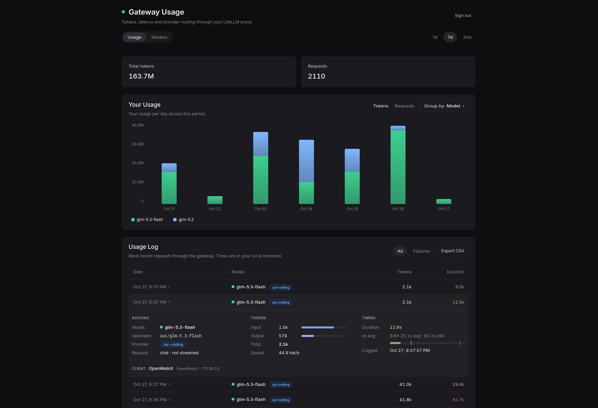

# litellm-dash

A small usage dashboard for a [LiteLLM](https://github.com/BerriAI/litellm) proxy that runs without a database.



LiteLLM's built-in UI needs Postgres. This project needs nothing extra: a LiteLLM callback logs every request to a SQLite file, and a Bun web app reads that file (read-only) and shows token totals, a per-model or per-provider chart, and a request log with CSV export. Click a request to see its routing, token split, latency against the model's average and p95, and any error. It doesn't track cost.

## Setup

Requires [Bun](https://bun.sh) 1.4+ and a LiteLLM proxy with a writable data directory.

**1. Add the callback to LiteLLM.** Copy [`litellm-callback/usage_logger.py`](litellm-callback/usage_logger.py) next to your `config.yaml` and register it, then restart the proxy:

```yaml
litellm_settings:
  callbacks:
  - usage_logger.usage_logger
```

It writes to `/app/data/usage.db` by default (`LITELLM_USAGE_DB` to change).

**2. Run the dashboard** on a machine that can read that file:

```bash
git clone https://github.com/jrpbuilds/litellm-dash && cd litellm-dash
bun install
cp .env.example .env   # set LITELLM_DASH_DB, and a login if exposing it
bun start
```

**3. Open** <http://127.0.0.1:34998>.

## Configuration

Set in `.env` (see [`.env.example`](.env.example)) or the process environment.

| Variable | Default | |
|---|---|---|
| `LITELLM_DASH_DB` | `./data/usage.db` | Path to the callback's SQLite file |
| `HOST` / `PORT` | `127.0.0.1` / `34998` | Listen address |
| `LITELLM_DASH_USER` / `LITELLM_DASH_PASSWORD` | | Enables the login page |
| `LITELLM_DASH_SESSION_TTL_DAYS` | `30` | "Remember me" duration |
| `LITELLM_DASH_SESSION_SECRET` | derived from password | Cookie signing key |
| `LITELLM_DASH_TOKEN` | | Shared secret for scripts (`Authorization: Bearer` only) |
| `LITELLM_DASH_TRUST_PROXY` | `0` | Trust `X-Forwarded-*` / `CF-Connecting-IP` headers |
| `LITELLM_DASH_PROXY_URL` | | LiteLLM base URL. Lists every model via public `GET /v1/models` |
| `LITELLM_DASH_PROXY_TOKEN` | | Optional master key for `GET /model/info` (provider, price, capabilities). Only `http:` and `https:` URLs are called |

Callback settings (set in the LiteLLM container):

| Variable | Default | |
|---|---|---|
| `LITELLM_USAGE_DB` | `/app/data/usage.db` | Where to write |
| `LITELLM_USAGE_RETENTION_DAYS` | `90` | Older rows are pruned |
| `LITELLM_USAGE_PROVIDERS` | | `https://api.example.com=example,...` names upstreams by `api_base`; others show their hostname |

## Authentication

- **Open** (default): no auth. The process refuses to listen on anything but loopback (`127.0.0.1`, `localhost`, `::1`) unless login or a token is set.
- **Login**: set `LITELLM_DASH_USER` and `LITELLM_DASH_PASSWORD`. Failed logins are rate-limited to 5 per 15 minutes per IP. Changing the password signs everyone out unless `LITELLM_DASH_SESSION_SECRET` is set. Login and logout reject a cross-site `Origin` or `Referer`.
- **Token**: set `LITELLM_DASH_TOKEN` for scripts and API clients. Send it as `Authorization: Bearer`; a `?token=` query parameter is ignored. It works alongside login.

Behind a reverse proxy or Cloudflare Tunnel, set `LITELLM_DASH_TRUST_PROXY=1` so rate limiting sees real client IPs and cookies are marked `Secure`. The proxy should also send `X-Frame-Options: DENY` and a `Content-Security-Policy` with `frame-ancestors 'none'` on `/` and `/login`; those two pages are Bun HTML bundles and cannot set response headers themselves. API responses already send those headers, plus `Cache-Control: no-store`.

## API

All `GET` endpoints take `days=1|7|30` (default 7) and require auth when enabled.

| Route | Returns |
|---|---|
| `GET /api/summary` | Request and token totals |
| `GET /api/chart?group=model\|provider` | Token totals per hour (1d) or day |
| `GET /api/latency?group=model\|provider` | Count, average, p95 and max duration |
| `GET /api/recent?limit=50&before_id=&status=failure` | Latest requests, newest first, paged by id. Not limited to `days` |
| `GET /api/export.csv?status=failure` | Requests in the window; `status=failure` omits successes |
| `GET /api/models` | Every advertised model plus usage in the window. Names only in the log are marked retired when the catalog was fetched |
| `GET /api/session` | `{ authenticated, mode }`, 401 when signed out |
| `POST /api/login` | Form fields `username`, `password`, `remember=on` |
| `POST /api/logout` | Clears the session |

## Development

```bash
bun run dev             # server with reload
bun test                # tests (bun run test:coverage for coverage)
bun run test:callback   # Python callback tests
bun run typecheck
```

[`scripts/dev.sh`](scripts/dev.sh) copies the usage DB from a remote LiteLLM host over SSH and starts the dev server against it. [`scripts/deploy.sh`](scripts/deploy.sh) syncs the repo to a deploy directory, restarts its systemd user unit and smoke-tests the endpoints. Both are configured through env vars documented at the top of each script.

<details>
<summary>Example systemd user unit</summary>

```ini
[Unit]
Description=litellm-dash

[Service]
WorkingDirectory=/opt/litellm-dash
ExecStart=/usr/local/bin/bun start
Restart=on-failure

[Install]
WantedBy=default.target
```

Configuration is read from `/opt/litellm-dash/.env`.
</details>

## License

[MIT](LICENSE). Not affiliated with LiteLLM. The design takes after Cursor's usage page.
